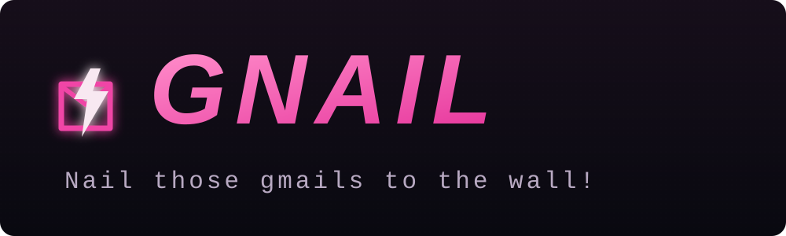

<div align="center">



### Your inbox. Less noise. More **you**.

**A local-first, agent-assisted Gmail triage queue.**  
Sort the pile quickly, keep the final say, and never let an agent click the button for you.

[Get started](#-quick-start) · [How it works](#-the-triage-loop) · [Safety](#-built-for-your-inbox-not-the-other-way-around) · [Development](#-development) · [MIT License](LICENSE)

</div>

---

> [!NOTE]
> GNAIL is an early-stage personal project. It can archive, trash, label, or create Gmail filters **only after you stage and execute those actions**. Start with demo mode and read the safety notes before connecting a real mailbox.

## ✨ What it does

- **Three useful piles:** Needs Eyes, Archivable, and Deletable.
- **Fast triage:** search, select, bulk-stage, and review a queue before it runs.
- **Human-controlled actions:** classification is a suggestion; Gmail changes require an explicit queue execution.
- **Local learning:** your corrections are stored locally and can guide later classifications.
- **Needs Eyes stays local:** flagged messages remain in Gmail and are skipped by later GNAIL fetches.
- **No sending, no permanent deletion:** Trash uses Gmail's recoverable Trash; sending is not implemented.

## 🚀 Quick start

### Requirements

- macOS or Linux
- Node.js 22 or newer
- [Gog CLI](https://github.com/steipete/gogcli) for Gmail access
- [OpenAI Codex CLI](https://github.com/openai/codex) for classification through your ChatGPT sign-in

GNAIL stores its local state in macOS Application Support or the Linux XDG data directory by default.

You can run GNAIL before connecting either external tool: it starts in clearly marked **demo mode**, using synthetic messages and local-only demo actions.

### Install and run

```sh
git clone https://github.com/Jon-Westbrook/Gnail.git
cd Gnail
npm install
npm start
```

Open <http://127.0.0.1:3457>. GNAIL binds to the loopback interface by default; it is not intended to be exposed directly to the public internet.

### Connect your own Gmail and ChatGPT

GNAIL invokes Gog and Codex CLI on the same machine. The first-run setup guide checks whether Gmail and ChatGPT are connected, then points you to each tool's own setup flow. It does not install tools or collect credentials.

Install Codex CLI and authenticate through its browser flow:

```sh
npm install -g @openai/codex
codex login
```

Set `GOG_ACCOUNT` when Gog has no default account. `GOG_BIN`, `CODEX_BIN`, and `CODEX_MODEL` can override the executable paths or classification model; if `CODEX_MODEL` is unset, Codex uses its configured default.

```sh
GOG_ACCOUNT=you@example.com npm start
```

For the Gmail connector, follow Gog's OAuth setup for your own Google Cloud project and account, requesting only Gmail access: `gog auth setup you@example.com --services gmail`. For the classifier, `codex login` opens the ChatGPT browser sign-in. Credentials remain under the CLI tools' own local credential stores. Do not put tokens, OAuth client secrets, mailbox exports, or `.env` files in this repository.

If a previously connected Gmail token expires or is revoked, reauthorize it with `gog auth add you@example.com --services gmail --force-consent`.

> **Classifier support today:** GNAIL currently uses Codex CLI and its ChatGPT browser authentication. Other model providers are not yet supported.

## 🌀 The triage loop

1. **Fetch** a batch of up to 50 inbox threads.
2. **Classify** them into Needs Eyes, Archivable, or Deletable.
3. **Review** subjects and sender details; search and select individual or grouped messages.
4. **Stage** your choices. Nothing changes in Gmail at this point.
5. **Execute the queue** when you are ready. Archive, Trash, label, and filter actions then run through Gog.

Archive and Trash decisions are kept as local feedback for future classification. A **Needs Eyes** decision is a local marker: it removes the item from active GNAIL triage without changing Gmail, and future fetches skip it.

## 🔒 Built for your inbox, not the other way around

- GNAIL is designed to run on a machine you control; its default server address is `127.0.0.1`.
- Message state, queue, and correction history are stored outside the repository (macOS Application Support or Linux XDG data directory). Override the location with `GNAIL_DATA_DIR`.
- AI classification sends the sender, subject, snippet, and list identifier to OpenAI through Codex CLI. Each classification uses an ephemeral Codex session, but you should still review OpenAI's privacy and data-handling terms before use.
- Queue execution can change Gmail. Inspect staged actions before selecting **EXECUTE QUEUE**.
- There is no message sending or permanent-delete action.
- Do not expose the server directly to the internet. A remote deployment needs an authenticated private network/reverse proxy and a separate credential/security review.

## 🧪 Development

```sh
npm test
npm audit --omit=dev
```

Tests use a disposable mock Gog executable and synthetic data; they do not need a real Gmail account. Never run a live queue execution as a QA shortcut.

## 🗺️ Roadmap

- More guided setup diagnostics, including clear feedback when the selected provider is not authenticated.
- A provider-neutral classifier interface beyond the current Codex integration.
- Guided, least-privilege Gmail setup and clearer connection diagnostics.
- Tailscale-only VPS deployment guide and service hardening.
- Optional separate, readable inbox view (Gmail remains the current place to read full message bodies).

## 🙌 Contributing

Issues and focused pull requests are welcome. Please include tests for behavior changes, use synthetic messages in QA, and never include personal email data or credentials in issues, screenshots, fixtures, or commits.

## License

GNAIL is available under the [MIT License](LICENSE).
